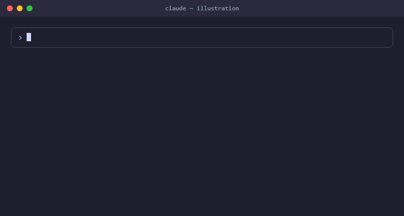

# claude-alert

[](https://github.com/mr-bala-kavi/claude-alert/actions/workflows/test.yml)

A Claude Code plugin that plays a sound when Claude needs you, so you don't miss it while you're working in another tab.

<p align="center"></p>

<sub>Illustration of the flow. The real plugin plays an actual sound.</sub>

## When it plays

- Claude asks you a question with recommendations (AskUserQuestion)
- Claude needs permission to run something
- Claude has finished and is waiting for your input

The sound **plays 5 times** and **stops as soon as you respond**: answer the question, approve the permission, or send a message. Each Claude Code session has its own alert, so answering in one window doesn't silence another.

## Install

Run in your terminal:

```
claude plugin marketplace add mr-bala-kavi/claude-alert
claude plugin install sound-alert@claude-alert
```

Restart Claude Code. That's all you need: the next time Claude asks a question, you'll hear the alert.

**Check it works:** in Claude Code, type
`Use the AskUserQuestion tool to ask me a test question`. The sound should start, then stop when you answer.

## Commands

Run these inside Claude Code. Each user's settings are saved in `~/.claude/sound-alert/`, so they're personal and stay when the plugin updates. No restart is needed after changing them.

| Command | What it does |
|---|---|
| `/sound-alert:set-sound <file>` | Use your own sound for every alert |
| `/sound-alert:set-sound <file> question` | Your own sound for questions only |
| `/sound-alert:set-sound <file> notify` | Your own sound for permission/waiting alerts only |
| `/sound-alert:set-sound show` | Show which sound is active |
| `/sound-alert:set-sound reset` | Go back to the default sound |
| `/sound-alert:set-repeat <1-50>` | How many times the sound plays |
| `/sound-alert:set-repeat show` | Show the current count |

### Use your own sound

<p align="center"></p>

<sub>Illustration of the command. A GIF can't play sound.</sub>

```
/sound-alert:set-sound ~/Downloads/my-sound.mp3
```

Any audio format works (MP3, M4A, WAV, …). Claude converts it to WAV with `ffmpeg` (or the built-in `afconvert` on macOS), test-plays it once, and saves it. Short clips of 1–3 seconds work best, because the sound repeats.

If you don't have `ffmpeg`: `winget install Gyan.FFmpeg` (Windows), `brew install ffmpeg` (macOS, optional), `sudo apt install ffmpeg` (Linux).

### Choose how many times it plays

<p align="center"></p>

<sub>Illustration of the command. A GIF can't play sound.</sub>

```
/sound-alert:set-repeat 3
```

Use `1` to play it just once. The sound stops early whenever you respond.

## Update

```
claude plugin marketplace update claude-alert
claude plugin update sound-alert@claude-alert
```

Restart Claude Code afterwards. Your own sound and repeat count are kept.

## Turn it off

```
claude plugin disable sound-alert@claude-alert     # pause (enable again with "enable")
claude plugin uninstall sound-alert@claude-alert   # remove
```

## Platform support

| Platform | Plays with | Extra setup | Tested |
|---|---|---|---|
| Windows | PowerShell | Git for Windows (Claude Code runs hooks through its `sh`) | Live in Claude Code |
| macOS | `afplay` (built in) | None | CI on a GitHub macOS runner, including real `afplay` playback |
| Linux | `pw-play`, `paplay`, `canberra-gtk-play` or `aplay` | An audio player, if none is installed | CI on Ubuntu, plus Kali on WSL2 |
| WSL | Windows, through PowerShell | None | Kali on WSL2 |

Servers, SSH sessions and other machines with no audio output can't play sound.

## Troubleshooting

- **No sound after installing or updating:** restart Claude Code. Hooks only load when a session starts.
- **Still no sound:** test the script directly. Put your installed version (from `claude plugin list`) in the path:
  `sh ~/.claude/plugins/cache/claude-alert/sound-alert/<version>/scripts/alert.sh question < /dev/null`
- **Custom sound or count is ignored:** an environment variable (below) overrides the commands. Run `/sound-alert:set-sound show` or `/sound-alert:set-repeat show` to check.
- **Linux is silent:** install a player, e.g. `sudo apt install pipewire-bin` (for `pw-play`) or `pulseaudio-utils` (for `paplay`).

## Advanced settings

Environment variables override the commands above. Set them in your shell or in the `"env"` block of `~/.claude/settings.json`.

| Variable | Default | What it does |
|---|---|---|
| `CLAUDE_ALERT_REPEAT` | `5` | How many times to play (1–50) |
| `CLAUDE_ALERT_GAP_SECONDS` | `1` | Pause between repeats |
| `CLAUDE_ALERT_MAX_SECONDS` | none | Optional time limit. `0` plays the sound once |
| `CLAUDE_ALERT_QUESTION_WAV` | bundled sound | Sound file for questions |
| `CLAUDE_ALERT_NOTIFY_WAV` | bundled sound | Sound file for permission/waiting alerts |

The sound is chosen in this order: environment variable → your sound from `/sound-alert:set-sound` → the bundled `sounds/alert.wav` → the system alert sound.

## For maintainers

- **Change the default sound for everyone:** replace `plugins/sound-alert/sounds/alert.wav` with a **16-bit PCM WAV** (Windows can't play MP3), bump `version` in `plugins/sound-alert/.claude-plugin/plugin.json`, and push.
- **Run the tests:** `sh tests/run.sh`. They use stub players, so nothing plays. CI runs them on macOS and Ubuntu for every push.

```
plugins/sound-alert/
├── .claude-plugin/plugin.json    plugin manifest (bump version on changes)
├── hooks/hooks.json              when alerts start and stop
├── scripts/alert.sh              cross-platform player + repeat loop
├── scripts/alert.ps1             Windows player
├── skills/set-sound/SKILL.md     /sound-alert:set-sound
├── skills/set-repeat/SKILL.md    /sound-alert:set-repeat
└── sounds/alert.wav              default sound
```
