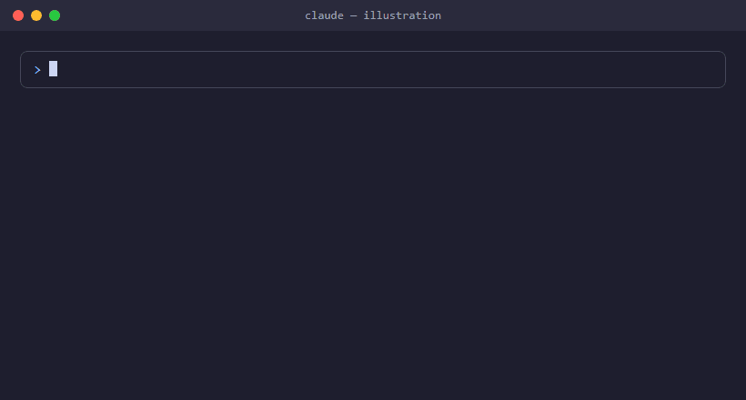

# claude-alert

A Claude Code plugin that plays a sound when Claude needs you — so you don't miss it while working in another tab.

<p align="center"></p>

<sub>Illustration of the flow — the real plugin plays an actual system sound.</sub>

## When it plays

- Claude asks a question (AskUserQuestion)
- Claude needs permission, or is waiting for your input

The plugin ships its own sound (`plugins/sound-alert/sounds/alert.wav`), so everyone who installs it hears the same alert on Windows, macOS and Linux.

## Install

```
claude plugin marketplace add mr-bala-kavi/claude-alert
claude plugin install sound-alert@claude-alert
```

Restart Claude Code after installing.

The sound **plays 5 times by default** and stops as soon as you respond (answer the question, approve the permission, or send a message).

## Use your own sound

<p align="center"></p>

<sub>Illustration of the command — sounds can't be shown in a GIF.</sub>

Run this inside Claude Code:

```
/sound-alert:set-sound ~/Downloads/my-sound.mp3            # for every alert
/sound-alert:set-sound ~/Downloads/question.mp3 question   # only questions
/sound-alert:set-sound ~/Downloads/permission.mp3 notify   # only permission/idle prompts
/sound-alert:set-sound show                                 # which sound is active
/sound-alert:set-sound reset                                # back to the default
```

Any audio format works — Claude converts it to WAV with `ffmpeg` (or `afconvert` on macOS) and saves it in `~/.claude/sound-alert/`, so your sound stays when the plugin updates. Short clips (1–3 s) work best because the sound repeats until you respond.

## Choose how many times it plays

```
/sound-alert:set-repeat 3      # play 3 times (1-50)
/sound-alert:set-repeat show   # current setting
```

The count is saved in `~/.claude/sound-alert/config`, so each user keeps their own and it stays when the plugin updates.

## Settings

Set these environment variables to change the behaviour:

| Variable | Default | What it does |
|---|---|---|
| `CLAUDE_ALERT_REPEAT` | `5` | How many times to play (1–50). Overrides `/sound-alert:set-repeat` |
| `CLAUDE_ALERT_MAX_SECONDS` | none | Optional time limit for ringing. `0` = play once |
| `CLAUDE_ALERT_GAP_SECONDS` | `1` | Pause between repeats |
| `CLAUDE_ALERT_QUESTION_WAV` | bundled `alert.wav` | Sound file for questions |
| `CLAUDE_ALERT_NOTIFY_WAV` | bundled `alert.wav` | Sound file for permission/idle notifications |

You can also set them in `~/.claude/settings.json` under `"env"`.

To change the sound for everyone, replace `sounds/alert.wav` with another **16-bit PCM WAV** file (Windows can't play MP3), bump the version in `plugin.json` and push.

## Test

```
sh plugins/sound-alert/scripts/alert.sh question
```

## Disable

```
claude plugin disable sound-alert@claude-alert
```

## Requirements

- Windows: Git for Windows (Claude Code runs hooks through its `sh`)
- macOS: nothing extra (`afplay` is built in)
- Linux: `pw-play` (PipeWire), `paplay` (PulseAudio), `canberra-gtk-play` or `aplay` (ALSA), plus the freedesktop sound theme (`sound-theme-freedesktop`) for the default sounds
- WSL: nothing extra — sounds play through Windows
