# claude-alert

A Claude Code plugin that plays a sound when Claude needs you — so you don't miss it while working in another tab.

<p align="center"></p>

<sub>Illustration of the flow — the real plugin plays an actual system sound.</sub>

## When it plays

| Event | Windows | macOS | Linux |
|---|---|---|---|
| Claude asks a question (AskUserQuestion) | Windows Notify | Glass | message-new-instant |
| Permission prompt / waiting for input | Windows Exclamation | Ping | bell |

## Install

```
claude plugin marketplace add mr-bala-kavi/claude-alert
claude plugin install sound-alert@claude-alert
```

Restart Claude Code after installing.

The sound **keeps repeating until you respond** — answering the question, approving the permission, or sending a message stops it. If nobody responds it stops on its own after 30 seconds.

## Settings

Set these environment variables to change the behaviour:

| Variable | Default | What it does |
|---|---|---|
| `CLAUDE_ALERT_MAX_SECONDS` | `30` | How long to keep ringing. `0` = play once only |
| `CLAUDE_ALERT_GAP_SECONDS` | `1` | Pause between repeats |
| `CLAUDE_ALERT_QUESTION_WAV` | system sound | Sound file for questions |
| `CLAUDE_ALERT_NOTIFY_WAV` | system sound | Sound file for permission/idle notifications |

You can also set them in `~/.claude/settings.json` under `"env"`.

## Test

```
sh plugins/sound-alert/scripts/alert.sh question
```

## Disable

```
claude plugin disable sound-alert@claude-alert
```

## Requirements

- Windows: Git for Windows (Claude Code runs hooks through its `sh`)
- macOS: nothing extra (`afplay` is built in)
- Linux: `pw-play` (PipeWire), `paplay` (PulseAudio), `canberra-gtk-play` or `aplay` (ALSA), plus the freedesktop sound theme (`sound-theme-freedesktop`) for the default sounds
- WSL: nothing extra — sounds play through Windows
